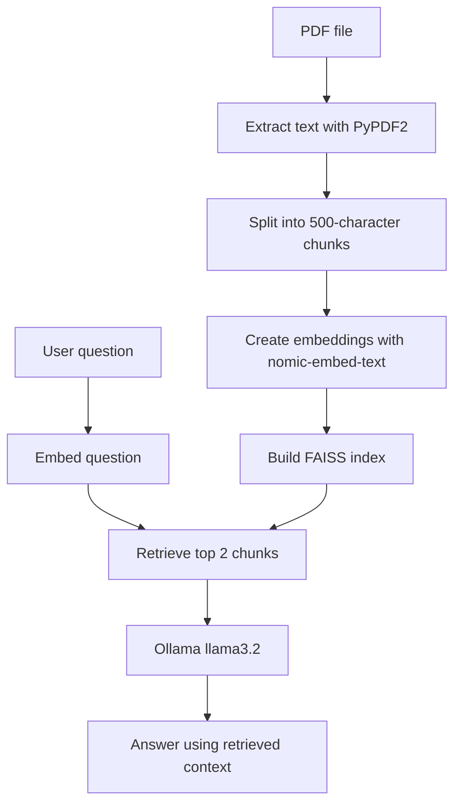

<!-- Ask My Document | futuristic project README -->
<div align="center">


<p><b>A PDF question-answering experiment using retrieval-augmented generation</b></p>


</div>

---

## `01 / OVERVIEW`

Ask My Document is a Python prototype that lets a user ask a question about a PDF. It extracts text, divides it into chunks, creates embeddings locally through Ollama, retrieves similar chunks with FAISS, and asks a local LLM to answer using the retrieved context.

The current `main.py` is a **terminal-based prototype**. It uses local models, not the OpenAI API.

## `02 / RETRIEVAL PIPELINE`



## `03 / TECH STACK`

- **Python** — application logic
- **PyPDF2** — PDF text extraction
- **Ollama** — local embedding and chat model runtime
- **nomic-embed-text** — embedding model used by the current script
- **FAISS** — nearest-neighbour vector search
- **NumPy** — embedding array handling
- **llama3.2** — local answer-generation model used by the current script

## `04 / GETTING STARTED`

### Prerequisites

- Python 3.10+ recommended
- [Ollama](https://ollama.com/) installed and running
- A text-based PDF file available locally

### 1. Clone the project

```bash
git clone https://github.com/rasswanthsura-cpu/ask-my-doc.git
cd ask-my-doc
```

### 2. Install Python dependencies

```bash
pip install PyPDF2 faiss-cpu numpy ollama
```

### 3. Download the local models

```bash
ollama pull nomic-embed-text
ollama pull llama3.2
```

### 4. Add a PDF and run

The current script looks for a file named `medicine.pdf` in the project directory. For your own use, place a PDF there and make sure you have permission to process its contents.

```bash
python main.py
```

When prompted, type a question about the document.

## `05 / CURRENT LIMITATIONS`

- The current script reads one configured PDF filename.
- Text is split by character count rather than semantic boundaries.
- Retrieval uses L2 distance and returns two chunks.
- The terminal flow accepts one question per run.
- The answer depends on the retrieved context and may still be incorrect; verify important information against the source document.

## `06 / ROADMAP`

- [ ] Add configurable PDF uploads and multi-document support
- [ ] Display retrieved source chunks with answers
- [ ] Add a chat interface and conversation history
- [ ] Add tests for parsing, retrieval, and answer generation
- [ ] Evaluate retrieval quality and reduce unsupported answers

## `07 / AUTHOR`

**Rasswanth S.** · [GitHub profile](https://github.com/rasswanthsura-cpu) · [Email](mailto:rasswanth.sura@gmail.com)

<div align="center">

</div>
